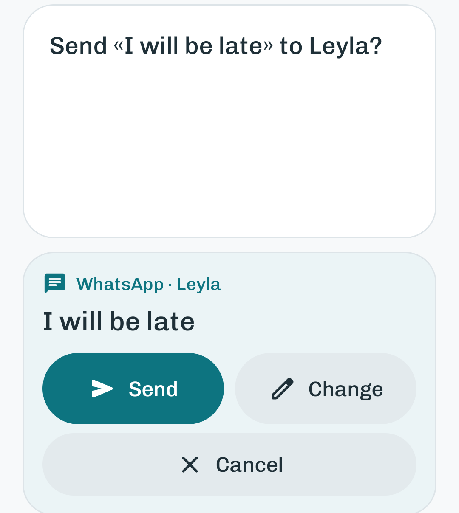

# GrandVoca

**A voice assistant for older people, in Azerbaijani and English.**

Say «Əli» and the assistant writes WhatsApp messages, records voice messages, makes calls, sets alarms and medicine reminders, reads a medicine box through the camera, explains what is on the screen and reads incoming messages aloud. It reads every message back and sends nothing until you confirm.

<p align="center">
  
</p>

| Part | Folder | What it is |
|---|---|---|
| Android app **«Köməkçi»** | [`android/`](android/) | The assistant. Kotlin and Jetpack Compose, Android 8.0+. It answers to «Əli» ("Ali" in English mode) |
| Backend | [`backend/`](backend/) | Node.js, TypeScript and Express. Keeps the API keys and talks to Gemini (or Claude) and Azure Speech |

Built in November 2026 for the UNEX hackathon. The original plan and demo script are in [MVP_PLAN.md](MVP_PLAN.md) (in Azerbaijani).

## Contents

- [Features](#features)
- [How it works](#how-it-works)
- [Repository layout](#repository-layout)
- [Getting started](#getting-started)
  - [Requirements](#requirements)
  - [1. Start the backend](#1-start-the-backend)
  - [2. Install the app](#2-install-the-app)
  - [3. Connect the phone to the backend](#3-connect-the-phone-to-the-backend)
  - [4. Set up the phone (once)](#4-set-up-the-phone-once)
- [Using the assistant](#using-the-assistant)
- [Voice messages](#voice-messages)
- [Languages](#languages)
- [Fast commands](#fast-commands)
- [Wake word](#wake-word)
- [Configuration](#configuration)
- [Testing and debugging](#testing-and-debugging)
- [Troubleshooting](#troubleshooting)
- [Security and privacy](#security-and-privacy)
- [Credits](#credits)

## Features

| Feature | What it does |
|---|---|
| Hands-free start | Say «Əli» and the app wakes up, even when it is closed. The wake word is recognised on the phone, offline |
| WhatsApp messages | Writes to family by name or by role (*my daughter*, *nəvəm*) and to anyone in your contacts. Reads the text back; you can fix a word by voice or keyboard |
| Voice messages | Records a voice message in the app. Say «Mellon» to stop, listen to it, then send it through WhatsApp |
| Calls and contacts | Calls by name or role, saves a new contact by voice, imports contacts from the phone |
| Alarms and reminders | "Wake me up at 7", "remind me about my medicine every day at 9 pm". The alarm fills the screen and says what it is for |
| Camera | Answers a question about what the camera sees: a medicine box, a leaflet, a bill, an expiry date |
| Screen reading | Explains the screen of any app: who wrote what, amounts, dates. Translates Russian and English text |
| Incoming messages | Reads new WhatsApp, SMS, Telegram and Viber messages and missed calls aloud, and answers questions about them |
| Two languages | Azerbaijani (default) and English. 108 common English commands are understood on the phone, without the backend |
| Made for older people | Large type, high contrast, touch targets of at least 56 dp, big Yes / No buttons for every question |

## How it works

The phone does as much as it can on its own. It calls the backend for Azerbaijani speech recognition and for sentences that need AI.

```
«Əli, nəvəmə yaz: salam»   ("Ali, text my grandchild: hello")
 │
 ├─ 1. Wake word  The phone hears «Əli» offline (Vosk). Nothing has been sent yet.
 ├─ 2. Speech     Azerbaijani: the backend turns the audio into text (Gemini or Azure).
 │                English: the phone's own speech recogniser.
 ├─ 3. Meaning    The phone tries first: a local parser and 108 English fast commands.
 │                Otherwise the backend asks Gemini or Claude for a structured action.
 ├─ 4. Confirm    «Murada «Salam» yazım?» ("Send «Salam» to Murad?") with Yes / No buttons.
 └─ 5. Act        «Hə» → WhatsApp opens the chat and the accessibility service taps Send.
```

| On the phone (Android app) | On the backend (Node.js) |
|---|---|
| Wake word «Əli» (Vosk, offline) | Speech to text for Azerbaijani (Gemini or Azure) |
| Conversation: who, what, confirm, correct | Understanding free-form sentences (Gemini or Claude) |
| Simple Azerbaijani commands and 108 English fast commands | Camera questions and screen explanations |
| WhatsApp, calls, contacts, alarms, camera | Natural Azerbaijani voice (Azure `az-AZ-BanuNeural`) |
| Voice-message recorder with the «Mellon» stop word | The API keys (they are never in the APK) |
| Reading notifications and the screen aloud | |

The backend API:

| Endpoint | Purpose |
|---|---|
| `GET /health` | Health check, used by the app's server status |
| `POST /api/intent` | A sentence → a structured action (message, call, alarm, answer…) |
| `POST /api/vision` | A camera photo and a question → a spoken answer |
| `POST /api/screen` | Text captured from the screen → an explanation |
| `POST /api/stt` | Audio → text |
| `POST /api/tts` | Text → Azerbaijani speech (Azure) |

When `APP_TOKEN` is set, every `/api` request must send it in the `X-App-Token` header. The app does this for you.

## Repository layout

```
NVATON/
├── android/                         Android app «Köməkçi»
│   └── app/src/main/
│       ├── java/az/nvaton/komekci/
│       │   ├── a11y/                Accessibility service: WhatsApp Send, screen reading
│       │   ├── actions/             Messages, voice messages, calls, phone controls
│       │   ├── alarms/              Alarms, reminders, the full-screen alarm
│       │   ├── core/                Dialog manager, local parser, fast commands, Azerbaijani grammar
│       │   ├── data/                Settings, family contacts, phone contacts
│       │   ├── net/                 Backend client
│       │   ├── notify/              Reads incoming notifications aloud
│       │   ├── ui/                  Compose screens, theme, icons
│       │   ├── voice/               Speech input, text-to-speech, voice-message recorder
│       │   └── wake/                Wake-word service and model loader
│       └── assets/
│           ├── commands/en.tsv      English fast commands
│           ├── wake-model/          Vosk model (scripts/get-wake-model.sh, not in git)
│           └── licenses/            Font licence
├── backend/
│   ├── src/                         index.ts (start), app.ts (routes), ai.ts, gemini.ts, claude.ts,
│   │                                stt.ts, tts.ts, prompts.ts, schemas.ts, *.test.ts
│   └── .env.example                 Template for backend/.env
├── scripts/
│   ├── emulator.sh                  Starts the emulator with the Mac's webcam and microphone
│   └── get-wake-model.sh            Downloads the wake-word model
├── dist/                            Prebuilt APK and install guide (not in git)
└── MVP_PLAN.md                      Original plan and demo script (Azerbaijani)
```

## Getting started

The app starts in Azerbaijani. Labels are given in English, with the Azerbaijani label in italics where it helps: ⚙️ → **Setup** (*Quraşdırma*). To use the app in English, choose **English** in ⚙️ → **Dil / Language**.

### Requirements

- **Node.js 20.12+** for the backend.
- **Android Studio**, or JDK 17+ with Android SDK 36, to build the app.
- **An Android 8.0+ phone with WhatsApp.** The app is built for ARM: it runs on real phones and Apple-silicon emulators, not on Intel (x86) emulators.
- **A Gemini API key** from [Google AI Studio](https://aistudio.google.com/apikey) (it has a free tier), or a [Claude API key](https://platform.claude.com/) instead.
- Optional: an **[Azure Speech](https://azure.microsoft.com/products/ai-services/speech-services) key**; the free F0 tier is enough. It gives Əli a natural Azerbaijani voice and can recognise Azerbaijani speech more accurately.

**Quick start** (each step is explained below):

```bash
# Terminal 1: the backend (leave it running)
cd backend
npm install
cp .env.example .env      # then put your GEMINI_API_KEY in backend/.env
npm run dev
```

```bash
# Terminal 2, from the repository root, with the phone connected by USB
scripts/get-wake-model.sh
(cd android && ./gradlew installDebug)
adb reverse tcp:8787 tcp:8787
```

Then open the app, go to ⚙️ → **Setup** and allow everything.

### 1. Start the backend

```bash
cd backend
npm install
cp .env.example .env
```

Open `backend/.env` and put your key after `GEMINI_API_KEY=`. Then start the server:

```bash
npm run dev
```

You should see:

```
Köməkçi backend: http://127.0.0.1:8787
  AI (gemini): ready
  Speech recognition: Gemini
  Azure TTS: off (the app will use on-device TTS)
```

With an Azure key, the last two lines say `Azure (az-AZ)` and `ready`.

- Leave this terminal open, and run the other commands in a new terminal tab. A command typed into the server's terminal doesn't run.
- `npm run dev` restarts by itself when the code changes, but not when `.env` changes. After editing `.env`, press **Ctrl+C** and run `npm run dev` again.
- The server also runs without any key. The app then understands simple commands (message, call, open the camera) on the phone; only the AI features stop working.

> **Why the backend recognises Azerbaijani speech.** Google's on-device speech recogniser has no Azerbaijani model (`does not support locale: az-AZ`). So when the backend has a Gemini or Azure key, the app records your voice and the backend turns it into text. Without a key, the app tries the phone's recogniser. Typing a command always works.

All the settings are listed in [Configuration](#configuration).

### 2. Install the app

**a) Put `adb` on your PATH** (macOS, once). Otherwise you get `zsh: command not found: adb`.

```bash
echo 'export PATH="$HOME/Library/Android/sdk/platform-tools:$HOME/Library/Android/sdk/emulator:$PATH"' >> ~/.zshrc && source ~/.zshrc
```

**b) Connect a device.** Without one, the install stops with `No connected devices!`.

- **Phone.** Use one for the demo: WhatsApp and the microphone only really work there. Go to Settings → About phone, tap **Build number** 7 times, then turn on Developer options → **USB debugging**. Connect the cable and tap **Allow** when the phone asks about USB debugging.
- **Emulator.** This script starts it with the Mac's webcam as the phone's camera and the Mac's microphone switched on:

  ```bash
  scripts/emulator.sh
  ```

  Allow camera and microphone access if macOS asks. An emulator started from Android Studio's Device Manager has the Mac microphone off: turn on ⋯ → Microphone → **Virtual microphone uses host audio input**.

Check that the device is listed with the word `device`:

```bash
adb devices
```

**c) Download the wake-word model** (once, about 37 MB). It isn't in git. Without it the app still works, but it won't wake up when you say «Əli», and «Mellon» won't stop a voice message (the Stop button still does).

```bash
scripts/get-wake-model.sh
```

**d) Build and install.** In Android Studio: File → Open → the `android/` folder → ▶ Run. Or from the terminal:

```bash
cd android && ./gradlew installDebug
```

If Gradle can't find Java, point it at Android Studio's JDK first:

```bash
export JAVA_HOME="/Applications/Android Studio.app/Contents/jbr/Contents/Home"
```

**Prebuilt APK.** The shared package has a ready release build in `dist/` (not in git). To install it:

```bash
adb install -r dist/Komekci-0.1.0.apk
```

### 3. Connect the phone to the backend

Over USB (this works for the emulator too):

```bash
adb reverse tcp:8787 tcp:8787
```

The app calls `http://127.0.0.1:8787` by default, and this command forwards that address on the phone to the backend on your laptop. Run it again whenever you reconnect the phone, restart the emulator or run `adb kill-server`.

With a phone **and** an emulator connected, plain `adb reverse` fails with "more than one device". Add `-d` for the USB phone or `-e` for the emulator:

```bash
adb -d reverse tcp:8787 tcp:8787
```

**Over Wi-Fi:** in `backend/.env`, set `HOST=0.0.0.0` and `APP_TOKEN=<a secret word>`, then restart the backend. In the app, open ⚙️, enter `http://<laptop-IP>:8787` as the **Server address** (*Server ünvanı*) and the same token as **APP_TOKEN**, then tap **Save and test** (*Yadda saxla və yoxla*). Always set a token: without it, anyone on the same Wi-Fi can use your API key.

### 4. Set up the phone (once)

Open the app → ⚙️ → **Setup** (*Quraşdırma*) and tap **Open** (*Aç*) next to every item that isn't done yet:

| Item | What to do |
|---|---|
| **Microphone**, **Camera**, **Phone calls**, **Contacts: message anyone**, **Show notifications** (*Mikrofon, Kamera, Zəng etmək, Kontaktlar, Bildiriş göstərmək*) | Allow |
| **Read incoming messages** (*Gələn mesajları oxumaq*) | In Android's **Notification access** list, turn on **Köməkçi: gələn mesajları oxumaq** (on a phone set to English: **Köməkçi: reading incoming messages**) |
| **Write on WhatsApp, read the screen** (*WhatsApp-da yazmaq, ekranı oxumaq*) | In Android's **Accessibility** settings, turn on **Köməkçi: WhatsApp-da göndərmə və ekranı oxumaq** (in English: **Köməkçi: WhatsApp sending and screen reading**). This one permission covers both |
| **Alarms on the full screen** (*Zəngli saat bütün ekranda*), Android 14+ | Allow |

Then add your people: ⚙️ → **Family contacts** (*Ailə kontaktları*). The demo contacts have fake numbers (`+994 00 …`). Replace them with real numbers, and fill in **What you call them** (*Necə çağırırsınız*) with words such as `nəvəm` (my grandchild) or `qızım` (my daughter).

> **Switch greyed out (Android 13+)?** Settings → Apps → Köməkçi → ⋮ (top right) → **Allow restricted settings**. Then turn on notification access and accessibility again.

> **After every install**, look at ⚙️ → Setup again: Android may turn the accessibility service off when the app is reinstalled. If you are updating from an older build, also turn on notification access again once, because the service was renamed.

> **Xiaomi / Redmi (HyperOS, MIUI):** for Developer options, tap **HyperOS version** in About phone 7 times; USB debugging is under Additional settings → Developer options. When you plug in the cable, set the USB mode to **File transfer**. So that «Əli» works in the background, set Apps → Köməkçi → **Autostart** on and **Battery saver** to **No restrictions**.

## Using the assistant

Start with **«Əli»** (no button needed, see [Wake word](#wake-word)) or tap **Speak** (*Danış*). Every question also shows big **Yes / No** (*Hə / Yox*) buttons. In a noisy room, tap **Type** (*Yaz*) and type the command; diacritics are optional, so `neveme yaz salam` works.

The examples below are in Azerbaijani, the default language. For English, see [Languages](#languages).

### Messages and calls

| Say | Meaning | What happens |
|---|---|---|
| «Əli» … «nəvəmə yaz: salam» | Ali … text my grandchild: hello | «Bəli?» (Yes?) → «Kimə yazım: Murada, yoxsa Aysuya?» (Murad or Aysu?) → «Murada» → «Murada «Salam» yazım?» → «Hə» → sent on WhatsApp |
| «Əli, nəvəmə yaz: salam» in one breath | | Skips «Bəli?» and asks who straight away |
| «Qızıma de ki axşam gəlsin» | Tell my daughter to come in the evening | «Leylaya «Axşam gəlsin» yazım?» |
| «Əli, qızıma WhatsApp-dan salam yaz və göndər» | Ali, write hello to my daughter on WhatsApp and send it | «Leylaya «Salam» yazım?»: "on WhatsApp" and "send it" stay out of the message |
| «Əli, WhatsApp-dan Kamrana yaz ki sabah görüşək» | Ali, write to Kamran that we'll meet tomorrow | Works for anyone, not only family: it looks in the phone's contacts, then in WhatsApp search. Groups too: «Ailə qrupuna yaz: axşam gəlin». It still asks before sending |
| «Oğluma zəng et» | Call my son | Calls |
| «Əli, Kamranla söhbəti aç» | Ali, open the chat with Kamran | Opens the WhatsApp chat. «Əli, ekranı oxu» then reads it, and «ona yaz ki gəlirəm» (tell him I'm coming) replies in it |

**Fixing a message.** The draft appears in large type with **Send / Change / Cancel** (*Göndər / Dəyiş / Ləğv et*). **Change** opens it for typing; then tap **Save** (*Saxla*), or **Speak** (*Danış*) to say it again. You can also fix it by voice:

- Say the right version: «yox, axşam gələcəm yaz» (no, write "I'll come in the evening"), «gəlirəm yox, gələcəm» (not "I'm coming" but "I'll come"), or just the right word: «gələcəm».
- Give an instruction, and the AI makes the change: «sonuna sağ ol əlavə et» (add "thanks" at the end), «beşi altı elə» (make the five a six).
- Send it to someone else: «Aysuya göndər» (send it to Aysu).

After every change Əli asks again: nothing is sent without «hə». «Yox», «göndərmə» or «yox, sağ ol» (no / don't send / no, thanks) cancel.

### Contacts

| Say | Meaning | What happens |
|---|---|---|
| «Əli, Rauf adlı yeni kontakt saxla, nömrəsi sıfır əlli, yüz iyirmi üç, qırx beş, altmış yeddi» | Ali, save a new contact called Rauf, number 050 123 45 67 (said in words) | Reads it back («Rauf, 050 123 45 67. Yadda saxlayım?») and saves it after «hə». With phone-contacts integration on, it saves it to the phone too. Asks for a missing name or number |
| *(the number is already saved under another name)* | | «Bu nömrə artıq «Murad» adı ilə var…» → **Keep the old one / Replace / Merge** (*Köhnəni saxla / Əvəz et / Birləşdir*) |
| «Əli, telefon kontaktlarımı əlavə et» | Ali, add my phone contacts | Opens the import screen with search. If one number has several names, it asks which one to keep; the others become nicknames |

### Alarms and reminders

| Say | Meaning | What happens |
|---|---|---|
| «Əli, sabah səhər 7-də oyat» | Ali, wake me up at 7 tomorrow morning | Sets an alarm |
| «Hər gün axşam 9-da dərmanımı xatırlat» | Remind me about my medicine every day at 9 pm | Sets a daily reminder |
| «10 dəqiqədən sonra zəng çal» | Ring in 10 minutes | Sets a one-off alarm |
| «Zəngli saatlarım hansılardır?», «axşamkı xatırlatmanı sil», «bütün zəngli saatları sil» | What alarms do I have? Delete the evening reminder. Delete all alarms | Reads the list, deletes one or all. The list is also in ⚙️ → **Alarms** (*Zəngli saatlar*) |

When an alarm goes off, it fills the screen, Əli says what it is for, and it rings until you tap **Stop** (*Söndür*) or **In 5 minutes** (*5 dəqiqə sonra*).

### Camera and screen

| Say | Meaning | What happens |
|---|---|---|
| «Bu dərman nə üçündür?», «Bu nədir?» | What is this medicine for? What is this? | Opens the camera, says «Kameranı tutun, şəkil çəkirəm» (hold the camera, I'm taking a photo), takes the photo itself and answers that question |
| On the camera screen: «Bəs gündə neçə dəfə içim?», «Son istifadə tarixi keçib?» | How many times a day should I take it? Has it expired? | Takes a new photo. It remembers the earlier answers, so short follow-ups work |
| «Kameranı aç» | Open the camera | Opens the camera and waits for **Ask** (*Soruş*) or **Read** (*Oxu*) |
| On the camera screen: «Bağla» | Close | Goes back to the home screen |
| In any app: «Əli, ekranı oxu», «Əli, ekranda kim yazıb?» | Ali, read the screen. Who wrote on the screen? | Reads and explains the screen: who wrote what, amounts, dates. Translates Russian and English text |

On the camera screen, tap to focus and pinch to zoom. **Light on** (*İşığı yandır*) appears when the phone has a torch.

In a WhatsApp chat, «Əli, ekranı oxu» reads every message with its sender and time and marks the ones you wrote; then you can ask follow-up questions.

### Incoming messages

New WhatsApp, SMS, Telegram and Viber messages, missed calls and reminders are read aloud as they arrive: «Yeni mesaj, WhatsApp. Murad: …» (New message, WhatsApp. Murad: …). Əli stays quiet while it is talking, while you are talking, during calls and in Do Not Disturb.

| Say | Meaning | What happens |
|---|---|---|
| «Əli, mesajlarımı oxu», «kim yazıb?» | Ali, read my messages. Who wrote? | Reads the latest messages: from whom, in which app, when |
| «nə vaxt gələcək?» | When is he coming? | Answers from those messages |

To turn it off: ⚙️ → **Read incoming messages aloud** (*Gələn mesajları səsli oxu*). It needs notification access ([setup](#4-set-up-the-phone-once)).

### Everything else

| Say | Meaning | What happens |
|---|---|---|
| «Əli, dili ingilis dilinə dəyiş» | Ali, switch the language to English | Switches to English; *"switch to Azerbaijani"* switches back |
| «Nə edə bilirsən?» | What can you do? | Lists what it can do |
| Any other question | | A short answer from the AI |

## Voice messages

Əli records the voice message itself, and you end it with the word **«Mellon»**.

1. Say «Əli, Əzizə səsli mesaj göndər» (Ali, send Əziz a voice message). Əli answers: «Əzizə səsli mesaj. İndi danışın, qurtaranda «Mellon» deyin.» (A voice message to Əziz. Speak now, and say «Mellon» when you're done.)
2. Speak. The screen shows a timer and a sound-level bar. When you're done, say **«Mellon»** or tap the big red **Stop** (*Dayan*) button. The moment where you said «Mellon» is cut off the end. Recording stops by itself after 3 minutes.
3. Əli asks «Əzizə səsli mesajı göndərim?» (Shall I send the voice message to Əziz?). The card has **Listen**, **Send**, **Again** and **Cancel** (*Dinlə, Göndər, Yenidən, Ləğv et*). By voice, «hə» sends it, «yenidən» records it again and «yox» drops it.
4. After «hə», WhatsApp opens Əziz's chat with the recording attached. Tap WhatsApp's send button: Əli never sends a voice message on its own.

Good to know:

- In English, say *"send my son a voice message"*. The stop word is «Mellon» in both languages.
- «Mellon» is heard by the same offline model as the wake word, so the model must be installed ([step 2c](#2-install-the-app)). Without it, use the Stop button.
- Əli doesn't listen for its name while recording. The audio (AAC, mono, 16 kHz) stays in the app's private storage, and each new recording replaces the previous one.
- For someone found only through WhatsApp search, WhatsApp asks whom to send it to.
- WhatsApp has to be installed. Without it, Əli says «Səsli mesaj üçün telefonda WhatsApp olmalıdır» (WhatsApp is needed for voice messages).

## Languages

Azerbaijani is the default. Choose **English** in ⚙️ → **Dil / Language**, or say «dili ingilis dilinə dəyiş». The screen, Əli's voice (the phone's English voice), speech recognition and the AI's answers all switch to English, and the choice is remembered.

| Say | What happens |
|---|---|
| *"Ali"* … *"text my daughter that I'll be late"* | «Send «I'll be late» to Leyla?» → *"yes"* → sent on WhatsApp |
| *"Ali, text my grandson hello"* | «Who should I write to: Murad or Aysu?» → *"the second one"* |
| *"no, say I'll come tonight"*, *"change tomorrow to tonight"* (while a message waits) | Corrects the message and reads it back. **Change** opens it for typing |
| *"send my son a voice message"* | Records a voice message; say «Mellon» to stop |
| *"Ali, what is this medicine?"* | Opens the camera, takes a photo and answers in English |
| *"Ali, read the screen"* | Reads the screen, translating Azerbaijani or Russian text |
| *"call my son"*, *"what can you do?"* | Calls; lists what it can do |

- Roles in your contacts, such as `nəvəm`, `qızım` and `oğlum`, work in English too: *my grandson*, *my daughter*, *my son*.
- Say the wake word as "Ali"; the same offline model hears it.
- The Azure voice is Azerbaijani only. In English mode, the phone's own voice speaks.
- Common commands are understood on the phone (see [Fast commands](#fast-commands)). Other sentences, the camera and screen reading need the backend.

## Fast commands

108 everyday English commands, listed in [`en.tsv`](android/app/src/main/assets/commands/en.tsv), are understood on the phone itself in a few milliseconds; the backend isn't involved. In English mode, the phone's own recogniser turns speech into text, and the answer shows **Understood on the phone · 3 ms**. A sentence that isn't on the list goes to the AI as usual. The list is also in ⚙️ → **Fast commands**.

| Category | Commands | Examples |
|---|---:|---|
| Sound and light | 24 | *"turn up the volume"*, *"turn on the flashlight"*, *"I can't hear you"* |
| Messages | 16 | *"text my daughter that I'll be late"*, *"send my son a voice message"* |
| Alarms | 15 | *"wake me up tomorrow at 6:30"*, *"remind me to take my medicine every day at 9 pm"* |
| Time and phone | 14 | *"what time is it"* |
| Assistant | 12 | *"say that again"*, *"speak slower"*, *"stop"* |
| Reading | 7 | *"read the screen"*, *"read this message to me"* |
| Safety | 6 | *"call an ambulance"* (asks before dialling 103), *"help"* (asks whom to call: ambulance, 112 or family) |
| Calls | 6 | *"call my son"*, *"give Murad a ring"* |
| Health | 4 | *"I took my pills"*, *"did I take my medicine today?"* |
| Apps | 4 | *"open WhatsApp"*, *"open the camera"* |

The file is plain text, so the team can extend it. Each line is `category | INTENT | pattern`:

```
calls | CALL | (call/phone/ring/dial) {contact}
messages | MESSAGE | (text/message) {contact} (that/saying) {text}
health | MEDICINE_CHECK | did i take my (medicine/pills/tablets/medication) [today]
```

In a pattern, `(a/b)` means one of the words is required and `[a/b]` means the word is optional. `{contact}`, `{text}`, `{time}`, `{duration}`, `{app}` and `{service}` are slots. Lines are tried from top to bottom. A new phrasing for an existing intent is just a new line; a new intent also needs code.

## Wake word

- After you open the app once, it waits for «Əli» in the background. The home screen shows **Ready · say «Əli»** (*Hazıram · «Əli» deyin*).
- Android shows a notification and the green microphone dot while it listens; it requires this of every app that listens in the background.
- Even when the app is closed or in the background, saying «Əli» brings it to the front, and it answers «Bəli?» (Yes?).
- The name is recognised **on the phone, offline**, by a small [Vosk](https://alphacephei.com/vosk/) model. There is no Azerbaijani Vosk model, so the app uses the Turkish one, which hears «Əli» as "ali" or "eli". Audio goes to the backend only **after** the name is heard.
- The name has to start the sentence. «Onun əli ağrıyır» (his hand hurts) or «Allah razı olsun» (thank you) don't wake it.
- It doesn't listen for its name while it is speaking or listening to you, so its own voice never wakes it.
- To turn it off: ⚙️ → **Start when I say «Əli»** (*«Əli» deyəndə özü işə düşsün*), or **Turn off** (*Söndür*) in its notification.
- You can rename the assistant in ⚙️ → **Assistant's name** (*Köməkçinin adı*). The Turkish model has to know the new name: common names such as Ayla, Leyla or Xanım work.

## Configuration

The backend reads `backend/.env`; start from [`.env.example`](backend/.env.example). Restart the backend after you change it.

| Variable | Default | Purpose |
|---|---|---|
| `GEMINI_API_KEY` | | Gemini: commands, camera and screen reading, Azerbaijani speech recognition |
| `GEMINI_MODEL` | `gemini-3.5-flash-lite` | Model for commands and speech (measured at about 1–3 s) |
| `GEMINI_VISION_MODEL` | `gemini-3.6-flash` | Model for the camera (about 6–9 s). If one model is overloaded (500, 503, 504), the other one answers |
| `AI_PROVIDER` | Gemini; Claude if only an Anthropic key is set | `gemini` or `claude` forces the provider |
| `ANTHROPIC_API_KEY` | | Claude key (`ANTHROPIC_AUTH_TOKEN` also works) |
| `CLAUDE_MODEL` | `claude-opus-5-5` | Claude model |
| `AZURE_SPEECH_KEY`, `AZURE_SPEECH_REGION` | | Azure Speech: Əli's natural Azerbaijani voice. When set, Azure also does the speech recognition instead of Gemini. Left empty, the phone's own voice speaks |
| `AZURE_SPEECH_VOICE` | `az-AZ-BanuNeural` | Azure voice |
| `AZURE_STT_LANGUAGE` | `az-AZ` | Azure recognition language |
| `HOST` | `127.0.0.1` | `0.0.0.0` accepts connections over Wi-Fi |
| `PORT` | `8787` | Port |
| `APP_TOKEN` | | Shared secret for Wi-Fi use; the app sends it in the `X-App-Token` header |

Notes on models:

- `gemini-3.8-flash` took 75 seconds on the free tier, which is too slow for a voice assistant.
- Aliases ending in `-latest`, such as `gemini-flash-latest`, don't exist in the `v1` API that this SDK uses.
- With Claude, the server-side fallback (`fallbacks: "default"`) is on: if a safety classifier declines a request, the API automatically retries it on the recommended model.

## Testing and debugging

### Unit tests

```bash
cd backend && npm test
```

```bash
cd android && ./gradlew testDebugUnitTest
```

The backend has 34 tests (API routes and the Gemini client); the Android app has 97 (dialogs, Azerbaijani grammar, English and fast commands, message correction, voice messages, the wake word). `npm run typecheck` checks the backend's types.

### Try it without speaking

These hooks work in **debug builds only** (`installDebug`); the release APK ignores them. When the text has spaces, put the whole `adb shell` command in double quotes, or the phone cuts it at the first space.

Send a command as if it was spoken:

```bash
adb shell "am start -n az.nvaton.komekci/.MainActivity --es command 'nəvəmə yaz salam'"
```

Ask about what the camera sees (it opens the camera, takes a photo and answers):

```bash
adb shell "am start -n az.nvaton.komekci/.MainActivity --es command 'bu nədir?'"
```

Act as if «Əli» was heard:

```bash
adb shell am start -n az.nvaton.komekci/.MainActivity --ez simulate_wake true
```

Stop listening and speaking:

```bash
adb shell am start -n az.nvaton.komekci/.MainActivity --ez stop true
```

Start recording a voice message to a contact:

```bash
adb shell am start -n az.nvaton.komekci/.MainActivity --es voice_test Murad
```

Read the screen without the microphone (the app steps aside, captures the screen behind it, then continues as if you said «ekranı oxu»):

```bash
adb shell am start -n az.nvaton.komekci/.MainActivity --ez screen_test true
```

Test the wake word with a sound file (16 kHz mono WAV, as if the microphone heard it):

```bash
adb exec-in run-as az.nvaton.komekci sh -c 'cat > files/ali.wav' < ali.wav
```

```bash
adb shell am start -n az.nvaton.komekci/.MainActivity --es wake_test ali.wav
```

See what the wake-word model hears:

```bash
adb logcat -s WakeWord
```

### Release build

```bash
cd android && ./gradlew assembleRelease
```

The APK is written to `android/app/build/outputs/apk/release/app-release.apk`. R8 removes unused code and resources, and only ARM code is included, so the APK is 58.6 MB instead of 76 MB. The biggest part is the offline wake-word model (about 37 MB). For the hackathon the release build is signed with the debug key, so it installs on any phone; use a real keystore for Google Play.

## Troubleshooting

| Problem | Fix |
|---|---|
| `No connected devices!` | No phone is connected and no emulator is running. See [step 2b](#2-install-the-app) and check with `adb devices` |
| `zsh: command not found: adb` | `adb` isn't on your PATH: see [step 2a](#2-install-the-app) |
| `adb: more than one device/emulator` | Add `-d` (USB phone) or `-e` (emulator) to the command |
| `INSTALL_FAILED_NO_MATCHING_ABIS` | The app is ARM-only. Use a real phone or an ARM (Apple-silicon) emulator |
| `EADDRINUSE: address already in use :::8787` | The backend is already running in another terminal. Stop one of them with Ctrl+C |
| «Serverə qoşula bilmədim» (I couldn't reach the server) | Is the backend running? Did you run `adb reverse tcp:8787 tcp:8787`? Then ⚙️ → **Save and test** (*Yadda saxla və yoxla*) |
| «Süni intellekt hələ qoşulmayıb» (the AI isn't connected yet) | `GEMINI_API_KEY` is missing or wrong in `backend/.env`. The backend's terminal says which |
| `429` or `rate limit` in the backend log | Gemini's free-tier limit is used up. Wait a little, or switch to a paid plan in Google AI Studio |
| «Süni intellekt hazırda çox məşğuldur» (the AI is very busy right now) | Gemini is overloaded (503). The backend has already tried the other Gemini model; ask again in a moment |
| Azerbaijani speech isn't understood | Add a Gemini or Azure key to `backend/.env`; the app then uses the server's recognition (⚙️ → **Server speech recognition** (*Serverin nitq tanıması*) must be on). Or type the command |
| Əli speaks with a Turkish accent | The phone has no Azerbaijani voice. Add an Azure key to the backend |
| WhatsApp opens but the message isn't sent | The accessibility service is off ([step 4](#4-set-up-the-phone-once)). The number must be in international format: `+994…` |
| «Səsli mesaj üçün telefonda WhatsApp olmalıdır» | WhatsApp isn't installed, for example on the emulator |
| «Mellon» doesn't stop the recording | Say it clearly, close to the phone, after a short pause, or tap **Stop** (*Dayan*). Without the wake-word model, only the button works |
| After «hə», WhatsApp opens but the voice message isn't sent | That's by design: tap WhatsApp's send button |
| Saying «Əli» does nothing | ⚙️ → the wake-word section should say **Waiting for its name** (*Adını gözləyir*). If it says the model isn't in the app, run `scripts/get-wake-model.sh` and install again. On the emulator, the Mac microphone must be on (`scripts/emulator.sh`). Say the name close to the phone and pause briefly after it. `adb logcat -s WakeWord` shows what the model hears |
| On the emulator, «Əli» stops working after a while | The emulator loses the Mac microphone after a minute or two: `adb logcat -s WakeWord` shows `peak 0` or a constant `peak 23191` (a synthetic tone). Restart it with `scripts/emulator.sh`. Real phones don't do this |
| The alarm shows only a notification, not the full screen | ⚙️ → Setup → **Alarms on the full screen** → Open (Android 14+). On Xiaomi, also turn on **Autostart** |
| Phone contacts don't show up | ⚙️ → Family contacts → turn on **Use the phone's contacts** (*Telefon kontaktları ilə inteqrasiya*) and allow access, then tap **Add from the phone** (*Telefondan əlavə et*) |
| «Kamrana yaz» doesn't find the person | ⚙️ → Setup → **Contacts: message anyone** → Open. Names that aren't in your contacts, and groups, are found through WhatsApp search, which needs the accessibility service |
| Incoming messages aren't read aloud | ⚙️ → Setup → **Read incoming messages** must be marked done, and **Read incoming messages aloud** (*Gələn mesajları səsli oxu*) must be on. Nothing is read in Do Not Disturb |
| «Oxumaq istədiyiniz ekranı açın» (open the screen you want me to read) | The screen is captured the moment you say the name. If you opened Köməkçi first, the screen is Köməkçi itself. Say «Əli, ekranı oxu» while the other app is open |
| The emulator camera shows a virtual room | Start the emulator with `scripts/emulator.sh`, or set Android Studio → Device Manager → ✏️ → Camera → Back to **Webcam0** |
| Emulator: "Speech Recognition and Synthesis from Google keeps stopping" | Google's Turkish voice crashes on Apple-silicon emulators. The app notices and switches to Google's online voice for a few seconds, so just close the dialog. Real phones and the Azure voice don't have this problem |

## Security and privacy

**Keys**

- API keys live only in `backend/.env` (ignored by git), never in the APK.
- For Wi-Fi use, set `APP_TOKEN`. The backend prints a warning when it listens on the network without one.

**Microphone**

- While waiting for «Əli», the sound is processed only on the phone and is never sent anywhere.
- With server speech recognition, the app records only after you tap the microphone button or say «Əli», and only until you stop talking. The audio is sent to Gemini or Azure for recognition and isn't stored.
- Voice messages are recorded only when you ask for one, stay in the app's private storage, and go to WhatsApp only after you confirm. You press send yourself.

**Screen, camera and messages**

- The screen is captured only when you say «Əli». It stays in memory for 3 minutes, and password fields are never read. Its text goes to the backend (Gemini) only when you say «ekranı oxu».
- A camera photo is taken only when you ask a question or tap **Read** (*Oxu*), and is sent to the backend for the answer.
- Incoming notifications are read aloud on the phone only. The latest messages stay in memory (not on disk) for up to 3 hours, for «mesajlarımı oxu». They go to the backend only when you ask a question about them, such as «nə vaxt gələcək?».

**Actions**

- The accessibility service presses buttons only in WhatsApp, and only sends a message you confirmed by voice within the last 20 seconds. If the text box doesn't match the confirmed text, it presses nothing.

**Data on the phone**

- The phone's contacts are used only after you agree (in Settings or on the import screen), and you can turn this off at any time. They are searched on the phone; the backend sees only the name you said, such as «Kamran».
- Alarms are stored on the phone. To understand a command, the backend sees only their times and labels.
- Every request tells the backend the language (`language: "az"` or `"en"`); nothing else changes.

**AI providers**

- On Gemini's free tier, Google may use requests to improve its products. Use the paid tier for real users' messages.

## Credits

- Offline speech: [Vosk](https://alphacephei.com/vosk/) (`vosk-android`) and the `vosk-model-small-tr-0.3` model, Apache-2.0.
- Font: [Chivo](https://fonts.google.com/specimen/Chivo), SIL Open Font License 1.1 ([licence](android/app/src/main/assets/licenses/Chivo-OFL.txt)).
- Icons: Material Symbols Rounded, Apache-2.0, stored as path data in `ui/AppIcons.kt`.
- Design: built with the [taste skill](https://github.com/Leonxlnx/taste-skill): the "Frost and slate" palette (light background, dark slate text, one teal accent) and the same card, button pair and corner radius everywhere.
- AI and speech: Google Gemini, Anthropic Claude (optional), Azure AI Speech (optional).
